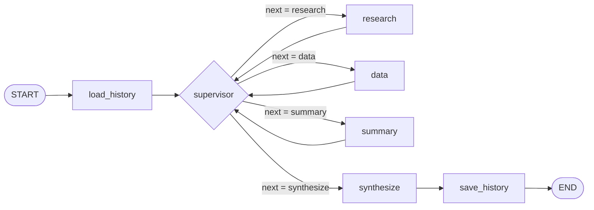
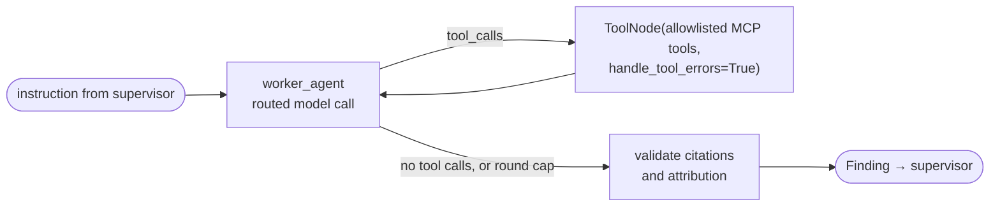

# Architecture

A LangGraph supervisor routes each question to three specialized workers. The workers retrieve from a
corpus of 220 arXiv papers (RAG), a SQLite paper database, and the live web, all through MCP. A final
node streams the answer over SSE with validated citations. Generation is split between Gemini (fast
tier) and Claude (strong tier), and each provider is the other's fallback. Session history lives in
Firestore, so it survives instance replacement on Cloud Run.

## Orchestration graph

`graph/build.py` assembles an explicit `StateGraph`. The supervisor's conditional edge dispatches on
`state["next"]`, a field set by the supervisor's structured output, never by matching the query text.



Each worker node is a compiled subgraph, wrapped by `guarded()` (`graph/guard.py`) and traced:



- **Supervisor** (`graph/supervisor.py`):
  - **What it reads:** the question, the earlier turns, `findings`, `errors`, `dispatches` and
    `step`.
  - **What it returns:** a `SupervisorDecision{next, instruction, task_type, reason}`. A question
    that needs no tools ("what's a point cloud?") goes straight to `synthesize`.
  - **Hard bounds:**
    - `MAX_SUPERVISOR_STEPS` (6) decisions per turn.
    - No repeat of the same worker and instruction twice in a row.
    - At most `MAX_WORKER_RETRIES` (1) retries of a failed worker, with a new instruction.
    - LangGraph's `recursion_limit` (2 × steps + 6).
- **Workers** (`graph/workers.py`):
  - **Loop:** an agent ⇄ ToolNode loop of up to `WORKER_MAX_TOOL_ROUNDS` (4; `data` gets 5,
    `summary` 4). The worker ends by writing a `Finding` to state.
  - **Citation checks:** every cited ID must have come from this run's tool results. A claim that
    names one paper but cites another paper's chunk fails the attribution check. Either failure
    gets one rewrite request; whatever still fails is marked `[unverified]`.
- **Guard:** an exception or a run past `WORKER_TIMEOUT_S` (60 s) becomes an `AgentError`
  (`worker_timeout`, `transport`, `provider_error` or `worker_exception`), so the graph keeps going.
- **Synthesize** (`graph/synthesize.py`):
  - **Input:** the findings only, using `prompts/synthesize.md`, with no new facts.
  - **Output:** it streams tokens tagged `synthesize`, then validates the answer's citations against
    the union of the findings' citations.
  - **Failure:** if the model fails, the answer ends with a fixed notice, so the graph always ends
    with a final message.

## State schema (`graph/state.py`)

```python
class OrchestratorState(TypedDict):
    session_id: str
    messages: Annotated[list[AnyMessage], add_messages]  # history + this turn
    next: str                                            # set by the supervisor's structured output
    instruction: str
    task_type: str            # lookup | compare | lit_review | metadata | current_events | general
    step: int
    findings: Annotated[list[Finding], operator.add]     # agent, content, citations, grounded, queries
    retrieved_chunk_ids: Annotated[list[str], operator.add]
    routing: Annotated[list[RoutingDecision], operator.add]
    errors: Annotated[list[AgentError], operator.add]
    dispatches: Annotated[list[Dispatch], operator.add]  # worker + instruction, in order
    answer_citations: CitationReport                     # {valid: [Citation], invalid: [id]}
```

- `Finding.grounded` is true if at least one citation survived validation, or if a `run_sql` query
  in that run returned rows. An aggregate such as counts per year has no single paper to cite.
- `Finding.queries` lists the SQL that ran successfully.
- `RoutingDecision = {call_site, agent, provider, model, tier, dimension, reason, fallback}`.

## Agents

Specialization means a distinct tool allowlist (`agents/registry.py`) and a distinct prompt
(`prompts/<agent>.md`). `mcp_client.py` filters the discovered MCP tools per agent, so a worker never
sees a tool outside its allowlist.

| Agent | Responsibility | Tools | Default tier (model) |
|---|---|---|---|
| `supervisor` | Pick the next worker, its instruction, the `task_type` and a one-line reason, or route to `synthesize`. Resolves follow-ups ("the second one") from earlier turns. | none (structured output) | fast (`gemini-3.8-flash`) |
| `research` | Grounded answers from paper text and the live web: how a method works, a two-method comparison, recent work. It cites every claim by chunk ID, keeps corpus and web findings separate, and says "not in corpus" rather than guess. | `search_corpus`, `get_paper_metadata`, `tavily_search` | fast; strong (`claude-sonnet-5-5`) for compare and lit_review |
| `data` | Text-to-SQL over paper metadata and benchmark results. It inspects the schema first, reports the exact SQL, never invents numbers, flags unverified rows and differing settings, and ranks by `higher_is_better`. | `describe_schema`, `run_sql`, `get_paper_metadata` | fast; strong after a `run_sql` error |
| `summary` | Multi-paper summaries and literature reviews: evidence grouped by paper, every citation kept, disagreements between papers flagged. | `search_corpus`, `get_chunks`, `get_paper_metadata`, `tavily_extract` | strong; fast when one paper is in scope |
| `synthesize` | Final answer node (not an agent): composes the streamed answer from findings only and renders citations. | none | fast; strong for large or multi-source answers |

## Provider routing (`router.py`)

`router.route(call_site, features)` is a pure function of inspectable state features. Every decision is
streamed as a `routing` event, stored in `routing`, and unit-tested.

| Call site | Default | Escalate (or downgrade) when | Dimension |
|---|---|---|---|
| `supervisor` | fast | never: classification is cheap | cost |
| `data` | fast | a `run_sql` call in this run errored | hybrid |
| `research` | fast | `task_type ∈ {compare, lit_review}` | capability |
| `summary` | strong | downgrade to fast when exactly one paper is in scope | capability |
| `synthesize` | fast | ≥ 2 findings, ≥ 3 distinct papers cited, or estimated context > `STRONG_CONTEXT_TOKENS` (8000) | hybrid |

**Fallback:** fast is Gemini and strong is Claude, and each tier is the other's fallback
(`llm.FALLBACK`).
- **When it triggers:** a provider error (auth, 429, 5xx, timeout), or a supervisor call with no
  reply after `SUPERVISOR_TIMEOUT_S` (20 s). The call retries once on the other provider and records
  `fallback=True` with the original error class.
- **Within one worker run:** a tier that failed stays failed for the rest of the run.
- **Synthesize:** it falls back only before its first token has streamed.

**Thinking:** every call uses low thinking: Gemini's `thinking_level`, and Claude limited to the gaps
between tool calls. Claude's thinking blocks are signed and tied to the exact prompt prefix, so worker
histories are append-only.

**Mixing providers:** Claude accepts a Gemini tool-call history. Gemini accepts a Claude one; it drops
the thinking blocks and keeps the tool calls. So a mid-run switch needs no message rewriting.

**Why two providers:** OpenAI was a third, fallback-only tier until Phase 9. When the OpenAI credits
ran out, corpus search (OpenAI embeddings) and the fallback for both other providers broke together.
In the forced-OpenAI run, every multi-paper question also hit the worker timeout.

## RAG pipeline

- **Corpus:** 220 arXiv papers (`cs.CV`, `cs.GR`, 2020–2026) on neural scene representations and
  3D reconstruction: NeRF and variants, fast radiance fields, 3D Gaussian Splatting, neural surfaces,
  learned MVS, feed-forward reconstruction, dynamic scenes, and neural SLAM.
  - **Selection:** `ingest/corpus_spec.yaml` lists 44 landmark seed papers plus per-topic arXiv
    queries. Candidates are ranked by Semantic Scholar citations, with a minimum number of 2025+
    papers per topic, and surveys and off-topic areas (avatars, detection, medical) are excluded.
- **Parsing** (`ingest/parse_pdfs.py`, PyMuPDF): text is split on section headings, and the
  references section is dropped (any appendix after it is kept).
  - Figure and table captions are kept as their own text.
  - Equation-only fragments are dropped instead of indexing garbled LaTeX.
- **Chunking** (`ingest/chunk.py`): the result is 4,741 chunks.
  - Body sections are split recursively (paragraphs → sentences → words) into chunks of up to about
    800 tokens with about 100 tokens of overlap, never crossing a section boundary.
  - Captions go into chunks of up to about 300 tokens (`section="captions"`).
  - Each arXiv abstract is one chunk (`section="abstract"`).
  - Chunk IDs are `{arxiv_id}#{section_slug}-{nn}`, for example `2308.04079#method-03`. They stay
    stable across re-ingestion.
- **Embedding** (`ingest/embed.py`): OpenAI `text-embedding-3-small`, cosine distance, in a Chroma
  collection persisted to `index/chroma/`.
  - Each chunk is embedded as `<title>\n<section>\n\n<text>`. A paper often never names itself (the
    3DGS paper never says "Gaussian Splatting"), and the title fixes that.
  - The stored document is the plain text.
  - Full embedding cost: $0.043.
- **Retrieval** (`rag/retriever.py`, an LCEL runnable behind the `corpus` MCP server): `k = 6` by
  default, bounded to 1–12, with optional `arxiv_ids` and `sections` filters.
  - **Re-ranking:** about 40 candidates are re-ranked by cosine similarity + 0.02 ×
    log10(1 + citations), so the paper that introduced a method can outrank follow-ups that restate
    it. The reported `score` stays the plain cosine similarity.
- **Augmentation** (`rag/format.py`): each chunk is rendered as `[chunk_id] (title, §section, p.N)`
  followed by its text. The worker prompts require a `[chunk_id]` on every corpus-derived claim.
- **Citations** (`rag/citations.py`): three formats.

  | Format | Example | Meaning |
  |---|---|---|
  | Corpus chunk | `[2308.04079#method-03]` | a chunk retrieved this turn |
  | Web result | `[web:1a2b3c4d]` | the first 8 hex characters of sha1 of the normalized URL, so a source keeps its ID across searches |
  | Database row | `[db:2308.04079]` | a paper that appeared in `run_sql` or `get_paper_metadata` results this turn |

  Validation runs in each worker and again on the final answer. Valid IDs go out in the `citations`
  SSE event with links, and invalid IDs are shown as unverified.
- **Paper database** (`index/papers.sqlite`):
  - **Contents:**
    - 220 `papers` rows (title, year, venue, citation count, category, URL), plus `authors` and
      `paper_authors`.
    - 10,002 `results` rows: 9,903 extracted by `ingest/extract_results.py` (`verified=0`) and 99
      hand-checked against the papers' tables (`verified=1`, `ingest/results_seed.csv`).
  - **Results schema:** `results(arxiv_id, benchmark, scene, metric, value, higher_is_better, setting,
    verified)`.

The index and database are built offline and baked into the image read-only. Nothing is fetched,
parsed or embedded at request time.

## MCP servers and tool sharing

| Server | Transport | Tools | Notes |
|---|---|---|---|
| `corpus` (ours, `mcp_servers/corpus.py`) | stdio | `search_corpus`, `get_chunks` | opens Chroma read-only; validates `k` and filters |
| `papers_db` (ours, `mcp_servers/papers_db.py`) | stdio | `describe_schema`, `run_sql`, `get_paper_metadata` | `file:...?mode=ro`; exactly one `SELECT`/`WITH`; rejects `PRAGMA`, `ATTACH`, DDL and DML; at most 200 rows; aborts long queries |
| `tavily` (Tavily Remote MCP) | streamable HTTP | `tavily_search`, `tavily_extract` | key in the URL query string, redacted in every log |

`mcp_client.py` holds one persistent session per server, opened at startup, so the Chroma index loads
once.
- **Startup:** startup waits for the servers, up to `MCP_START_TIMEOUT_S` (90 s), before the port
  opens. Cloud Run gives an instance full CPU only until its port opens and during requests, so
  servers started in the background on an idle instance were starved.
- **Failures:**
  - A server that fails to start, or dies mid-call, is marked unhealthy, and its calls return its
    `description` from `mcp_config.json`. That description is also added to the affected agents'
    prompts, so they say the capability is unavailable.
  - Each turn tries one background reconnect.
  - A tool call has a `TOOL_TIMEOUT_S` (30 s) limit, and a timeout comes back as a clean tool error.

**Why tools are shared:**
- **`search_corpus`** serves two different needs. `research` answers a question from the best chunks
  anywhere in the corpus. `summary` gathers evidence paper by paper, using the `arxiv_ids` filter.
- **`get_paper_metadata`** is used by all three workers. `research` and `summary` enrich citations
  with titles, years and venues. `data` resolves the arXiv IDs that its SQL returns.
- **`tavily`** is split by need. `research` searches (`tavily_search`) for current events and gaps in
  the corpus. `summary` extracts (`tavily_extract`) a full page it already has a URL for.

Sharing a tool doesn't make two agents the same: each has its own allowlist and prompt. The trace
shows which agent called which tool.

## Durable state (Firestore)

- **Schema:** `state_store.FirestoreHistory` stores `sessions/{session_id}/turns/{n:06d}`. Each turn
  holds the user message, the final answer, the cited IDs, the valid citations and a timestamp. The
  session document holds `turn_count` and `updated_at`.
- **Reading:** `load_history` reads the last `HISTORY_TURNS` (6) turns into `messages`, ahead of the
  current question. The supervisor sees each earlier answer (cut to 1,500 characters) with its cited
  IDs, which is how "summarize the second one" resolves to a concrete paper.
- **Writing:** `save_history` writes the turn after `synthesize`, using `create()` on `n + 1`.
  `create()` fails if the document exists, so a concurrent turn retries instead of overwriting.
  Turns whose answer failed aren't saved.
- **Failures:** every Firestore call is bounded by `FIRESTORE_TIMEOUT_S` (5 s). A store failure
  becomes a `history_unavailable` error, and the turn continues without history.
- **No checkpointer:** the graph is compiled without one. Firestore history is the only cross-request
  state. Traces aren't persisted.
- **Backends:** `STATE_BACKEND=firestore` on Cloud Run. `memory` (`InMemoryHistory`, not durable)
  is for local runs and tests. Different `session_id` values never share history.
- **Security:** the Cloud Run service account `paper-assistant-run` has only `roles/datastore.user`,
  and the client uses ADC with no key file.

## Streaming (SSE)

`POST /chat/stream` with `{"session_id", "message"}` returns `text/event-stream`. Events, in order of
first appearance: `routing`, `trace`, `token`, `citations`, `error`, `done`.
- **`done`:** carries the timings (`ttft_ms`, `retrieval_ms`, `llm_ms`, `total_ms`) and per-provider
  token usage. The stream always ends with `done`, including after an `error`.
- **Heartbeat:** a comment line goes out every 15 s.
- **Frontend** (`static/`, vanilla JS, no build step): it reads the POST stream with `fetch()` and a
  `ReadableStream`. It renders a routing badge per call site (with a ⚠ on a fallback), a collapsible
  trace panel, and clickable citation chips.
