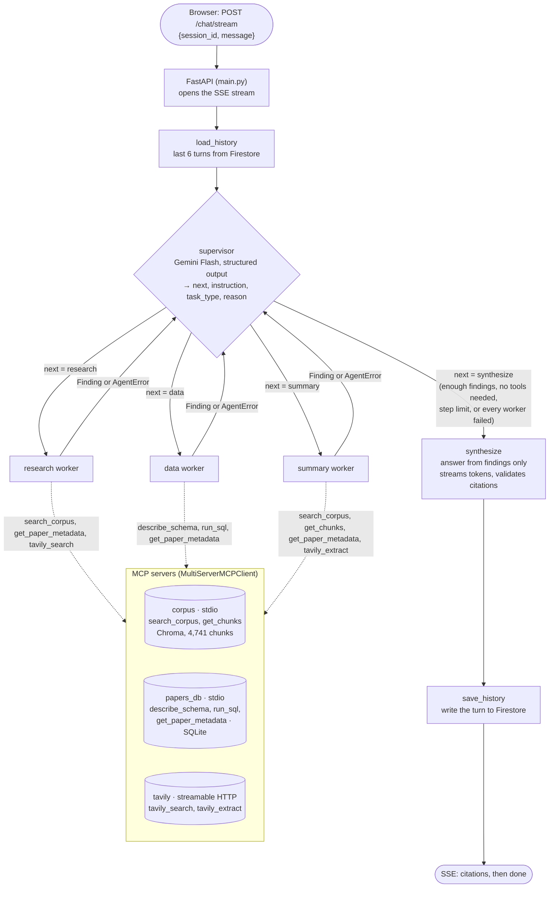
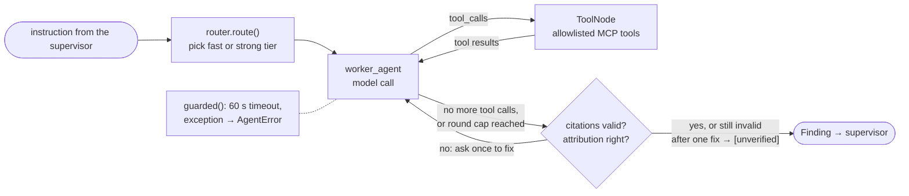
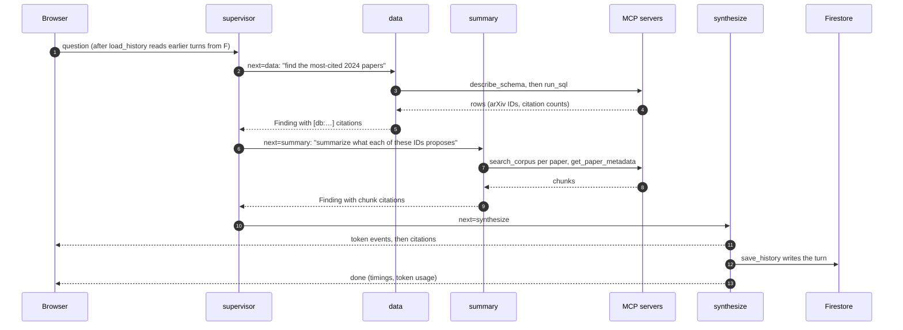

# Agent orchestration flow

How one question moves through the system, from the browser to the streamed answer. The graph is
built in `graph/build.py`; the full design is in [`architecture.md`](architecture.md).

## End to end

Every step also streams to the browser as it happens: a `routing` event for each model call, and
`trace` events for each node entry and exit, supervisor decision and tool call.

## Inside a worker

Each worker is its own compiled subgraph, with only the tools in its allowlist
(`agents/registry.py`) and its own prompt (`prompts/<agent>.md`):

| Worker | Default tier | Escalates to Claude Sonnet when | Tools |
|---|---|---|---|
| `research` | Gemini Flash | the task is a compare or a lit review | `search_corpus`, `get_paper_metadata`, `tavily_search` |
| `data` | Gemini Flash | the first SQL attempt this turn errored | `describe_schema`, `run_sql`, `get_paper_metadata` |
| `summary` | Claude Sonnet | (drops to Gemini when one paper is in scope) | `search_corpus`, `get_chunks`, `get_paper_metadata`, `tavily_extract` |
| `synthesize` | Gemini Flash | 2+ findings, 3+ papers cited, or a large context | none |

On a provider error, any call retries once on the other provider (Gemini ↔ Claude).

## An example turn

"Most-cited 2024 papers and what each proposes" needs two workers in turn:

## When something fails

| Failure | What happens | The user sees |
|---|---|---|
| A worker throws or passes 60 s | `guarded()` records an `AgentError`; the supervisor retries once with a new instruction, tries another worker, or synthesizes | a partial answer, still ending in `done` |
| A provider errors (timeout, 429, 5xx, bad key) | the call retries once on the other provider | `fallback=True` on the routing badge |
| An MCP server is down | its tools return a clear error, and the agents' prompts say the capability is unavailable | "corpus search is unavailable" in the answer |
| The supervisor's call fails | go straight to `synthesize` with what exists | an answer from the findings so far |
| `synthesize` fails | a fixed notice ends the answer | `error`, then `done` |
| Too many steps | `MAX_SUPERVISOR_STEPS` (6) forces `synthesize` | an answer from the findings so far |
